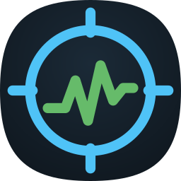

<div align="center">



# FrameScope

**Accurate FPS, frame-time, CPU, RAM and temperature overlay for Android. No root required.**

[](https://github.com/yashsaxena15/FrameScope/releases/latest)
[](https://github.com/yashsaxena15/FrameScope/actions/workflows/android.yml)
[](LICENSE)


</div>

FrameScope measures the frames that actually reach your screen, using the same
data Android's own graphics tools use. It shows them in a tiny overlay while you
play. It runs without root through [Shizuku](https://github.com/RikkaApps/Shizuku),
uses almost no memory or CPU, and has **no internet permission**.

---

## Features

- **Accurate FPS.** Counts every frame presented by SurfaceFlinger, exactly once, at 30–144 Hz. The game's surface is detected automatically.
- **Smoothness metrics.** Average FPS, **1% low** and **0.1% low** over the last 10 s, the latest frame time, and a stutter (jank) counter.
- **Live frame-time graph** with a display-refresh reference line.
- **CPU.** Total load, plus the current frequency of each core cluster, ordered slowest to fastest.
- **Memory.** System RAM used / usable, the RAM of the app in front, and optional swap (ZRAM + memory extension).
- **Temperatures.** SoC and battery, from Android's thermal service.
- **Four presets:**
  - **Minimal:** FPS only.
  - **Compact:** one line with FPS, CPU %, RAM % and SoC temperature.
  - **Standard:** FPS stats + graph.
  - **Full:** Standard + CPU, RAM and temperatures.
- **Made for gaming.** Drag to position, lock to let touches pass through, adjustable size and opacity. **Double-tap to reset stats** at the start of a match.
- **Quick Settings tile**, notification controls, and a built-in **?** help screen.
- **Lightweight.** About a 140 KB APK, no Compose, AppCompat or analytics, and a Canvas-drawn overlay that allocates nothing per frame.

## Requirements

- Android **10 or newer** (Android 11+ recommended: Shizuku can then start over Wireless debugging without a PC)
- [Shizuku](https://github.com/RikkaApps/Shizuku/releases), started via Wireless debugging, `adb`, or root

## Installation

1. Install and start **Shizuku**.
2. Download the latest `FrameScope-x.y.z.apk` from **[Releases](https://github.com/yashsaxena15/FrameScope/releases/latest)** and install it.
3. Open FrameScope and grant:
   - **Shizuku permission**
   - **Display over other apps**
   - **Notifications** (Android 13+)
4. Choose a preset and tap **Start overlay**, then open your game.

> Shizuku has to be started again after each reboot when it runs over ADB or Wireless debugging.

## Reading the overlay

**Compact preset:** `60 FPS · CPU 23% · RAM 79% · 42°` shows FPS, total CPU usage, RAM used by the whole device, and SoC temperature.

**Standard / Full presets:**

| Overlay | Meaning |
|---|---|
| `59.7 FPS @120Hz` | Frames presented in the last second · display refresh rate |
| `avg 59  1% 40  .1% 39` | Average FPS, 1% low and 0.1% low over the last 10 s |
| `16.7ms  jank 4` | Latest frame time · number of stutters since the last reset |
| graph | Frame time of the last 120 frames; spikes are slow frames |
| `CPU 50% 1.0\|0.6\|0.8 GHz` | CPU load · cluster frequencies, slowest → fastest |
| `RAM 8.6/11.0G 79% App 1.30G` | RAM used / usable by Android · RAM of the foreground app |
| `Swap 4.5/12.0G 38%` | Swap in use (ZRAM + memory extension), optional |
| `SoC 46°  Bat 39°` | Chip and battery temperature |

**Definitions.**
- *1% low* is the FPS equivalent of the average of the slowest 1% of frame times. *0.1% low* is the same for the slowest 0.1%.
- A *jank* is a frame that took more than twice the average of the previous three frames **and** longer than two display refreshes.

## Tested devices

| Device | SoC | Android | Status |
|---|---|---|---|
| POCO X8 Pro Max | MediaTek Dimensity 9500s | 16 (HyperOS 3) | ✅ Verified (120 Hz) |
| vivo 1938 | MediaTek Helio P35 (MT6765) | 12 | ✅ Verified (60 Hz) |
| Redmi 10A | MediaTek Helio G25 (MT6762) | 11 (MIUI 12.5) | ✅ Verified (60 Hz) |

FrameScope only uses standard Android and Linux interfaces, so it is expected to
work on other devices too. If something looks wrong on your phone, open
**Device probe** in the app, tap **Share**, and attach the report to an
[issue](https://github.com/yashsaxena15/FrameScope/issues).

## How it works

- **Frames.** FrameScope reads SurfaceFlinger's per-layer frame history (`--latency`, *actual present time*) every 250 ms. That is faster than the ~1 s the buffer covers at 120 Hz, so no frames are missed, and each timestamp is counted once.
- **Privileged helper.** A small helper process runs with shell privileges, started through Shizuku as `app_process` from the APK. It calls system services' `dump()` over binder directly, without spawning a process per sample, and talks to the app over a pipe. This also avoids Shizuku's UserService, which fails on many MediaTek devices ([Shizuku #1198](https://github.com/RikkaApps/Shizuku/issues/1198)).
- **System data** comes from `/proc/stat`, `/proc/meminfo`, `/proc/<pid>/status`, cpufreq sysfs and Android's thermal service.

## Privacy

FrameScope collects nothing and has **no internet permission**. See [PRIVACY.md](PRIVACY.md).

## Known limitations

- **GPU load and frequency** is an experimental option, off by default. Without root, most phones block the GPU's sysfs nodes, and on MediaTek Dimensity 9000+ the available kernel events do not reflect the real GPU clock.
- **Temperatures.** Without root, many phones report one chip-wide value for CPU and GPU, so FrameScope shows it once as *SoC*.

## Building

```bash
./gradlew :fpscore:test :framescope:assembleRelease
```

| Module | Contents |
|---|---|
| `:fpscore` | Pure Kotlin: frame-time math, parsers. Unit-tested with real captures from the devices above. |
| `:framescope` | The Android app: overlay, sampler, Shizuku helper. |
| `:app` | Legacy *PerformanceMonitorPro* prototype (root-only, Redmi Note 9). Not maintained. |

CI builds and tests every push. Pushing a `v*` tag publishes a signed release.

## Contributing

Issues and pull requests are welcome. Device probe reports from untested phones,
especially Snapdragon, Exynos and Tensor devices, are particularly helpful.

## License

FrameScope is free software, licensed under the **GNU General Public License v3.0**.
See [LICENSE](LICENSE).
